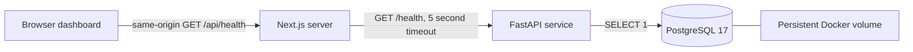

# DevForge AI architecture

## System boundary

DevForge AI implements infrastructure visibility and persistent Projects CRUD (Phase 2A). Planned autonomous engineering features are presented as a roadmap and are not executable.

## Frontend

The App Router serves a responsive dashboard with accessible navigation, keyboard focus styles, reduced-motion support, and live status announcements. CSS and system fonts avoid remote font or asset dependencies. The frontend is an npm workspace managed by the root lockfile.

The client polls a same-origin Next.js route every 30 seconds. The route reads server-only `BACKEND_URL` at runtime, fetches the API with a five-second timeout, and relays readiness results. Network failures produce a sanitized `503` response. The client validates the response shape and distinguishes API availability from database readiness. Static frontend health indicates that the dashboard has loaded; it is not a measurement of deployment history or uptime.

The standalone production image runs as the Node user. Monorepo output includes `frontend/server.js`, with static files copied beside its application directory.

## Backend

- `app/main.py`: application factory, CORS middleware, router registration, and database engine lifecycle.
- `app/core/config.py`: typed environment settings, JSON origin allowlist, and secret database URL.
- `app/db/session.py`: bounded connection pool and PostgreSQL probe.
- `app/api/health.py`: typed readiness response and independent liveness route.

The lifespan handler creates the engine once and disposes it on shutdown. Synchronous database operations execute in FastAPI's thread pool. Connection and statement timeouts are three seconds; stale pooled connections are checked before use.

`GET /health` returns `200` when PostgreSQL responds, or `503` when it cannot. The body includes `status`, `service`, `version`, and `database`. Driver messages and credentials are not exposed. `GET /health/live` returns `200` without querying PostgreSQL. `/docs` exposes generated OpenAPI documentation.

CORS permits only configured origins and GET, POST, PATCH, DELETE requests, without credentialed cross-origin requests. The dashboard proxy itself does not require CORS, but explicit CORS settings support direct API clients during development.

## Database and deployment

Compose starts PostgreSQL first, then the API after database readiness, then Next.js after API readiness. Health checks continue after startup. Compose dependency ordering does not restart a service automatically when a dependency becomes unhealthy; runtime outage reporting handles subsequent failures.

PostgreSQL uses a named data volume. Alembic manages the projects table. Compose runs migrations before Uvicorn; local developers run `alembic upgrade head` explicitly. The API does not create schemas implicitly. See [Projects Module](projects.md) for the domain layers and API contract.

Host ports bind to `127.0.0.1`. Container traffic uses service DNS (`backend`, `postgres`). Both application images run as non-root users. Secrets are injected via ignored environment files for local development; a future deployment should use its platform's secret manager.

## Verification and next boundaries

API tests cover success and degraded readiness, liveness, allowed and denied CORS origins, and database probe cleanup and failure handling. Frontend checks include ESLint, strict TypeScript, and a production build. Full database/container integration requires Docker or a running PostgreSQL installation.

Phase 2A adds domain models, a service/repository layer, and migrations for Projects.
Future phases should add authentication before public exposure and job orchestration
before AI execution. This foundation does not execute untrusted generated code.
